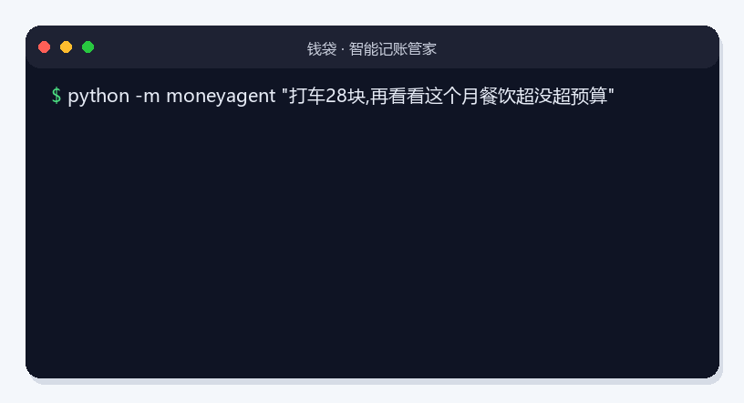
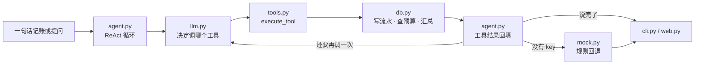

# QianDai MoneyAgent · Conversational Bookkeeping

[](https://github.com/wushiyi105-jpg/moneyagent/actions) []() [](./LICENSE) [](https://codecov.io/gh/wushiyi105-jpg/moneyagent)



> Record, query, budget and report money by chatting — it works through the steps by calling tools itself, you just watch.

An agent app for natural-language bookkeeping: the model completes tasks through **multi-step tool calls** — deciding for itself which of "record / query / check budget / summarise" to call, reading the result, then deciding the next step, until it produces the final answer. The ledger lives in SQLite and **persists across sessions**.

**Dual CLI + Web entry points, zero third-party dependencies, works out of the box.**

## ✨ Features

- 🧠 **Multi-step tool calls** — not a single round of Q&A; the model plans for itself "which tool, how many times"
- 💬 **Natural-language bookkeeping** — "今天中午吃了碗面15块" in one sentence: amount, category, merchant and time extracted automatically
- 🔍 **Duplicate check** — looks for an existing entry before recording, so nothing is booked twice
- 💰 **Budget management** — monthly per-category budgets with overspend alerts
- 📊 **Spending report** — a monthly report in one sentence: total in/out, category shares, budget status, saving advice
- 💾 **Cross-session memory** — transactions and budgets persist; they are still there next time
- 🖥 **Two entry points** — command line plus a Web UI that visualises every tool call
- ⚡ **Zero dependencies** — pure Python standard library, Python 3.10+ is enough

## 🚀 Quick start

```bash
git clone https://github.com/wushiyi105-jpg/moneyagent.git
cd moneyagent

# configure a model key
cp .env.example .env       # fill in LLM_API_KEY
#   or: export LLM_API_KEY=your-key

# start using it
python -m moneyagent "今天中午吃了碗面15块,帮我记一下"
```

It talks to DeepSeek by default (the cheapest, `deepseek-flash`).
> **⚠️ The project carries no API key of its own — put in your own** (`.env` is already gitignored and never committed).
With no key configured it falls into offline mode.

Run in Docker (the container uses the default port 8000):

```bash
docker build -t moneyagent .
docker run -p 8000:8000 moneyagent
```

## 📖 Command reference

```bash
# 💬 natural-language chat (record / query / report) — the default entry
python -m moneyagent "午饭花了25块,记一下"
python -m moneyagent "打车28块,再看看这个月餐饮超没超预算"

# 💰 budget
python -m moneyagent budget set 餐饮 500
python -m moneyagent budget show

# 🧾 ledger
python -m moneyagent ledger

# 📊 monthly spending report
python -m moneyagent report

# 🌐 Web UI (open http://127.0.0.1:8000)
python -m moneyagent web --port 8000

# global options
python -m moneyagent --json "这个月花了多少"    # raw JSON output
python -m moneyagent --mock "午饭25块"          # force offline mode
```

## 🤔 Why not just ask a general LLM

A general model can turn "lunch was a 15-yuan bowl of noodles" into an entry. But bookkeeping has three weak spots it cannot cover, and that is what MoneyAgent adds:

1. **The books have to reconcile** — amount, category, merchant and date are written to SQLite by tools; the model's job is choosing which tool to call and how often, not inventing numbers. You can query the ledger afterwards and check it against a statement, and a duplicate entry on the same day is caught before it is written.
2. **Data stays local** — income, expenses and budgets live in `data/moneyagent.db` and are never uploaded; the model receives only the sentence you typed, not your history.
3. **Offline still records** — with no key, rule matching still turns "spent 25 on a taxi" into an entry; convoluted sentences may be missed, and the same ledger keeps working once a key is added.
4. **The process is visible** — every tool call (record / query ledger / check budget / summarise) is kept in the output and expanded step by step in the Web UI; a chat answer gives you the conclusion with no way to see which step went wrong.

## 🎯 Use cases

- **Too tired to open a spreadsheet**: before bed, say each expense from the day in one sentence and they are filed by category; the next day ask "how much did I spend on food this week" and get the number without reconstructing it.
- **Budget nearly maxed**: set a monthly limit for food, get warned as you approach it, and read a month-end breakdown of category shares and overspend, so you know where the money leaked.
- **Small expenses that otherwise vanish**: taxis, groceries, things bought for the family all go into one ledger, summarised by category at month end faster than scrolling payment history.

## 🗺 Roadmap

- **Import payment statements**: read Alipay/WeChat CSV exports, merge them with manual entries and deduplicate.
- **Multiple ledgers and currencies**: keep a travel ledger and a household ledger apart, combine them for totals.
- **Recurring expense detection**: mark rent and memberships automatically instead of restating them each month.
- **Weekly and project budgets**: beyond monthly limits, cap one-off projects such as a trip or a renovation.
- **Report export**: write the monthly report out as Markdown/CSV for your own records.

## ❓ FAQ

**Where do I get an API key?**
The project ships without one. It talks to DeepSeek (`https://api.deepseek.com`) by default: create a key and put it in `.env` as `LLM_API_KEY`, or `export LLM_API_KEY=...`. Any OpenAI-compatible endpoint works — change `LLM_BASE_URL` and `LLM_MODEL`.

**Where is data stored, and is it uploaded?**
In `data/moneyagent.db`, a single SQLite file holding the ledger, budgets and reports on this machine. When a model is called, only the sentence from that request is sent, never the whole ledger.

**Does it work without a key?**
It records, using rules only: amounts and categories come from pattern matching, so loose phrasing can be missed. Configure a key for dependable natural-language bookkeeping.

**How do I switch models?**
Three environment variables — `LLM_BASE_URL`, `LLM_MODEL`, `LLM_API_KEY` — plus per-run overrides on the command line, with no code changes.

**Will the same expense be recorded twice?**
Before writing, it checks date, amount and merchant; the same expense is skipped and a different one still goes in. The dedupe result is stated in the output.

## 🧠 How it works (multi-step tool calling)

For the sentence "打车 28 块,再看看这个月餐饮超没超预算", the model executes on its own:

```
① query_transactions  → check whether today's ride is already recorded (duplicate guard)
② record_transaction  → record it: transport, 28 yuan
③ get_summary         → month's total expense / income / balance
④ get_budget          → the food budget
→ compose the answer: booked + monthly summary + how much budget is left
```

Six tools are available: `record_transaction`, `query_transactions`, `get_summary`, `get_budget`, `set_budget`, `delete_transaction`.

### Data flow

How one piece of data moves between the modules:



## 🔌 Model backends

Works with any **OpenAI-style `/chat/completions`** endpoint, **using your own API key**; three environment variables are all it takes:

| Platform | `LLM_BASE_URL` | `LLM_MODEL` |
|---|---|---|
| DeepSeek (default) | `https://api.deepseek.com` | `deepseek-flash` |
| OpenAI | `https://api.openai.com/v1` | `gpt-4o-mini` |
| Local Ollama | `http://localhost:11434/v1` | `qwen2.5` |

> `LLM_API_KEY` is required; `LLM_BASE_URL` and `LLM_MODEL` are optional.

## 🗂 Layout

```
moneyagent/
├── moneyagent/
│   ├── agent.py    # multi-step tool loop (ReAct) + offline fallback
│   ├── tools.py    # tool definitions and executor
│   ├── db.py       # SQLite ledger + budgets (thread safe, cross-session)
│   ├── llm.py      # LLM client (OpenAI-style API + .env loading + empty-response retry)
│   ├── mock.py     # offline rule engine (fallback / tests)
│   ├── cli.py      # command line entry
│   ├── web.py      # Web UI (visualises each tool call)
│   └── __main__.py
├── assets/demo.gif             # demo animation
├── tests/test_moneyagent.py    # offline path unit tests
├── .github/workflows/test.yml  # CI
├── .env.example
└── README.md
```

## ✅ Tests

Locally:

```bash
python -m unittest discover tests -v
```

Every push / PR runs the same suite on GitHub Actions across Python 3.10 / 3.11 / 3.12; see the `test` badge at the top.

## 👤 Author

- Name: shiyi
- Email: [wushiyi105@gmail.com](mailto:wushiyi105@gmail.com)
- Phone: 18384198104
- GitHub: [@wushiyi105-jpg](https://github.com/wushiyi105-jpg)

## 📄 License

[MIT](./LICENSE)
