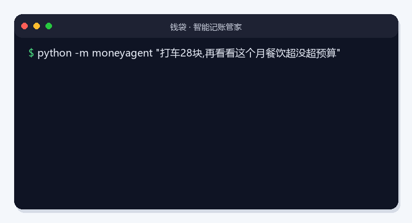
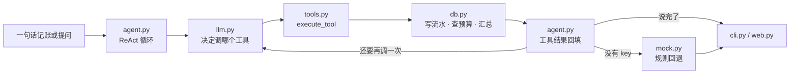

# 钱袋 QianDai · 智能记账财务管家

[](https://github.com/wushiyi105-jpg/moneyagent/actions) []() [](./LICENSE) [](https://codecov.io/gh/wushiyi105-jpg/moneyagent)



> 像聊天一样记账、查账、管预算、出报告——它会自己一步步调工具完成,你看着就行。

一个自然语言记账的智能体应用:大模型通过**多步工具调用**完成任务——自己决定
调用「记一笔 / 查流水 / 查预算 / 出汇总」中的哪个工具,拿到结果再决定下一步,
直到给出最终回答。账本用 SQLite **跨会话长期保存**。

**CLI + Web 双入口,零第三方依赖,开箱即用。**

## ✨ 特性

- 🧠 **多步工具调用** —— 不是单次问答,模型自主规划「调哪个工具、调几次」
- 💬 **自然语言记账** —— 「今天中午吃了碗面15块」一句话,自动提取金额、分类、商家、时间
- 🔍 **查重判断** —— 记账前先查是否重复,避免记两遍
- 💰 **预算管理** —— 设分类月预算,超支自动提醒
- 📊 **消费报告** —— 一句话出月度报告:总收支、分类占比、预算执行、省钱建议
- 💾 **跨会话记忆** —— 流水与预算持久化,下次打开还在
- 🖥 **双入口** —— 命令行 + 网页界面(网页里可视化每一步工具调用)
- ⚡ **零依赖** —— 纯 Python 标准库,Python 3.10+ 即可运行

## 🚀 快速开始

```bash
git clone https://github.com/wushiyi105-jpg/moneyagent.git
cd moneyagent

# 配置模型 key
cp .env.example .env       # 填入 LLM_API_KEY
#   或 export LLM_API_KEY=你的key

# 直接开用
python -m moneyagent "今天中午吃了碗面15块,帮我记一下"
```

默认对接 DeepSeek(最便宜的 `deepseek-flash`)。
> **⚠️ 项目不自带任何 API key,请填入你自己的 key**(`.env` 已 gitignore,不会提交)。
未配置 key 时自动进入离线模式。

Docker 运行(容器内用默认端口 8000):

```bash
docker build -t moneyagent .
docker run -p 8000:8000 moneyagent
```

## 📖 命令参考

```bash
# 💬 自然语言对话(记账/查账/报告)—— 默认入口
python -m moneyagent "午饭花了25块,记一下"
python -m moneyagent "打车28块,再看看这个月餐饮超没超预算"

# 💰 预算
python -m moneyagent budget set 餐饮 500
python -m moneyagent budget show

# 🧾 流水
python -m moneyagent ledger

# 📊 月度消费报告
python -m moneyagent report

# 🌐 Web 界面(浏览器打开 http://127.0.0.1:8000)
python -m moneyagent web --port 8000

# 全局选项
python -m moneyagent --json "这个月花了多少"    # 输出原始 JSON
python -m moneyagent --mock "午饭25块"          # 强制离线模式
```

## 🤔 为什么不用通用大模型直接问

通用模型能把「中午吃面 15 块」听成一支笔账,但记账这件事它有三处靠不住,钱迹补的正是这三处:

1. **账要能对得上** —— 金额、分类、商家、日期由工具写进 SQLite,模型的活是决定调哪个工具、调几次,不替你想数字。记完能查流水、月底能对着账单核;同一天同一笔再记一次,记账前会先查重。
2. **数据不出本机** —— 收支、预算都在 `data/moneyagent.db`,不上传;调模型时只发这一句描述,不发历史流水。
3. **离线也能记** —— 没有 key 时走规则匹配,常见的「吃了 XX 块」「打车 XX 元」照样入账,只是复杂句子容易漏;联网后同一本账继续用。
4. **过程看得见** —— 每一步工具调用(记一笔 / 查流水 / 查预算 / 出汇总)都留在输出里,Web 上逐步展开;通用对话只给结论,记错了也看不出错在哪一步。

## 🎯 适用场景

- **一天下来懒得开表格**:睡前把当天几笔各说一句话,它逐笔记进分类;第二天问「这周吃饭花了多少」,直接出数,不用回忆。
- **预算快到线**:给「吃饭」设月预算,记到接近上限会提醒;月底出一份分类占比和超支项,知道钱漏在哪。
- **零散开销不想丢**:打车、买菜、给孩子买东西都记在同一本账,月末按分类汇总,比翻支付账单快。

## 🗺 Roadmap

- **导入支付账单**:支持支付宝/微信导出的 CSV,与手记流水合并并去重。
- **多账本与币种**:出差的账、家庭的账分开记,汇总时再合并。
- **周期支出识别**:房租、会员这类每月固定的支出自动标记,不用重复说。
- **预算按周与按项目**:不只按月,旅行、装修这类一次性项目也能单独设上限。
- **报表导出**:把月度报告导出 Markdown/CSV,方便贴进自己的记录。

## ❓ FAQ

**API key 从哪来?**
项目不自带 key。默认接 DeepSeek(`https://api.deepseek.com`),注册后创建 key 填进 `.env` 的 `LLM_API_KEY`,或 `export LLM_API_KEY=...`。任何 OpenAI 兼容端点都能用,改 `LLM_BASE_URL` 与 `LLM_MODEL`。

**数据存在哪?会上传吗?**
默认 `data/moneyagent.db` 一个 SQLite 文件,流水、预算、报告都在这台机器上;调用模型时只发送你这一次说的那句话,不发整本账。

**没有 key 能不能用?**
能记,但只用规则:金额和分类靠模式匹配,口语绕一点就会漏。要稳定的自然语言记账还是配 key。

**怎么换模型?**
三个环境变量 `LLM_BASE_URL`、`LLM_MODEL`、`LLM_API_KEY`,命令行也支持临时覆盖,不用改代码。

**会不会同一笔记两遍?**
记账前会按日期、金额、商家做查重;确认是同一笔就跳过,不是会照记。查重结果在输出里写明。

## 🧠 工作原理(多步工具调用)

一句「打车 28 块,再看看这个月餐饮超没超预算」,模型会自主执行:

```
① query_transactions  → 先查今天是否已记过(判断重复记账)
② record_transaction  → 记下:交通 28 元
③ get_summary         → 查本月总支出/收入/结余
④ get_budget          → 查餐饮预算
→ 合成回答:已记账 + 本月汇总 + 预算还剩多少
```

可调用的 6 个工具:`record_transaction`、`query_transactions`、`get_summary`、`get_budget`、`set_budget`、`delete_transaction`。

### 数据流

一条数据在这几个模块之间怎么走：



## 🔌 模型接入

兼容任意 **OpenAI 风格 `/chat/completions`** 接口,**使用你自己的 API key**,改三个环境变量即可:

| 平台 | `LLM_BASE_URL` | `LLM_MODEL` |
|---|---|---|
| DeepSeek(默认) | `https://api.deepseek.com` | `deepseek-flash` |
| OpenAI | `https://api.openai.com/v1` | `gpt-4o-mini` |
| 本地 Ollama | `http://localhost:11434/v1` | `qwen2.5` |

> `LLM_API_KEY` 必填;`LLM_BASE_URL`、`LLM_MODEL` 选填。

## 🗂 目录结构

```
moneyagent/
├── moneyagent/
│   ├── agent.py    # 多步工具调用循环(ReAct)+ 离线回退
│   ├── tools.py    # 工具定义与执行器
│   ├── db.py       # SQLite 账本 + 预算(线程安全,跨会话)
│   ├── llm.py      # LLM 客户端(OpenAI 风格接口 + .env 加载 + 空响应重试)
│   ├── mock.py     # 离线规则引擎(兜底/测试)
│   ├── cli.py      # 命令行入口
│   ├── web.py      # Web 界面(可视化每一步工具调用)
│   └── __main__.py
├── assets/demo.gif             # 演示动图
├── tests/test_moneyagent.py    # 离线路径单元测试
├── .github/workflows/test.yml  # CI
├── .env.example
└── README.md
```

## ✅ 测试

本地:

```bash
python -m unittest discover tests -v
```

每次 push / PR 由 GitHub Actions 在 Python 3.10 / 3.11 / 3.12 上自动跑同一组测试,结果见顶部 `test` 徽章。

## 👤 作者

- 署名：shiyi
- 邮箱:[wushiyi105@gmail.com](mailto:wushiyi105@gmail.com)
- 电话:18384198104
- GitHub:[@wushiyi105-jpg](https://github.com/wushiyi105-jpg)

## 📄 License

[MIT](./LICENSE)
